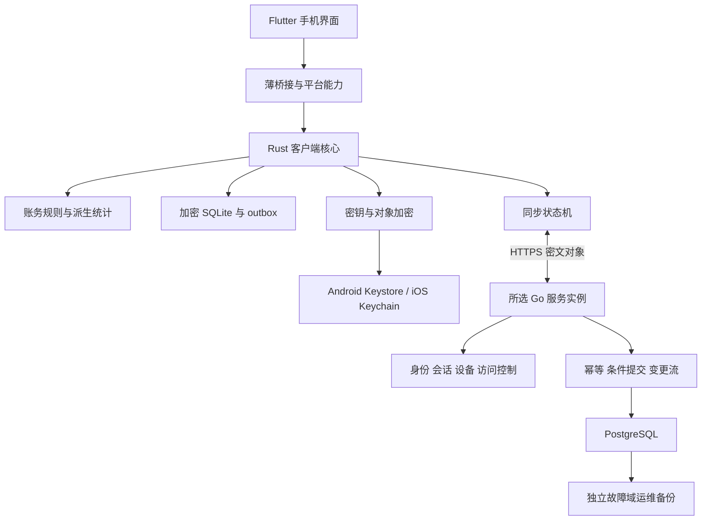

# 技术架构

采用移动客户端本地优先、服务端不可信的密文同步架构。业务保存、查询和统计不等待网络。官方与自部署采用同一核心服务端和协议，不共享必须在线的官方账号或授权依赖。

## 1. 分层与数据路径



平台密钥能力通过明确 adapter 接入，不要求 Flutter 直接掌握全部根密钥。图中是目标架构，实际采用方式需在 M0 验证。

| 层 | 负责 | 禁止形成的第二套职责 |
| --- | --- | --- |
| Flutter | 输入、导航、图表、错误和状态呈现 | 重复账务公式、独立实现同步或直接改核心数据库 |
| Rust 领域 | 金额、交易、账户变动、报表口径、引用验证 | 根据网络状态判断本地保存成功 |
| Rust 本地存储 | 事实 / 修订、索引、队列与事务 | 整个 DB 文件覆盖式日常同步 |
| Rust 密钥与加密 | KDF、包装、envelope、锁定与恢复 | 自造密码算法或服务端保管解密秘密 |
| Rust 同步 | transport、幂等、CAS、重放、冲突、域切换 | 依据手机时间 LWW 或隐式官方 fallback |
| 平台 adapter | 系统密钥、生命周期、文件分享和后台机会 | 自行定义不同平台的账务语义 |
| Go 服务 | 认证 / 授权、账号隔离、配额、密文提交 | 解密交易、搜索备注或计算余额 |

## 2. 选型与验证

| 项目 | 基线 | M0 要验证的代价 |
| --- | --- | --- |
| UI | Flutter | 两端 release 构建、输入、字号、依赖许可 |
| 共享核心 | Rust | bridge、线程、取消、所有权与生命周期 |
| 本地库 | SQLCipher / SQLite | 两端链接、正确启用加密、WAL / 临时文件、升级 |
| 密码实现 | 优先 RustCrypto 生态 | 具体版本、AEAD / KDF 向量、许可证、移动内存与耗时 |
| 后端 | Go 模块化单体 | 清楚事务边界、取消、限流和身份隔离 |
| 后端 DB | PostgreSQL | 原子提交、唯一约束、分页、恢复与容量 |

Rust 的价值来自单一账务和安全实现、跨端复用及可测试性。若 M0 显示接入成本与收益不匹配，需通过 ADR 调整架构；不能在 Flutter 内悄悄维护并行实现。

桥接比较现有 RadishLex 的薄 FFI 思路与 flutter_rust_bridge，不在验证前锁定其版本。SQLCipher 的随机数据库密钥由客户端生成，不把解锁口令直接当 DB 密钥。具体密码方案见[威胁模型](privacy-threat-model.md)。

最低 Android / iOS 版本、ABI、Flutter / Rust / Go 版本、系统密钥保护等级通过工具链与依赖矩阵冻结；框架支持不等于产品可用。优先覆盖 Android arm64、iOS 真机 arm64，开发模拟器作为额外验证面。

两端最小接入、桥接比较、加密和系统密钥的执行条件及证据要求见[移动端核心验证矩阵](development/mobile-core-validation.md)。合成接入实验的调用、存储边界、构建候选及复现入口见[移动核心实验](development/mobile-core-prototype.md)，实际证据统一进入 current；实验锁定值不代表生产选型或最低系统已冻结。

## 3. 本地事务与生命周期

保存一次交易：验证输入与引用 → 生成修订 → 同事务写事实和不可变 outbox → 提交后返回本机成功 → 独立启动同步。

本地事实、修订和索引保持明确来源。数据库迁移先备份，校验 schema；无法打开或解密时进入恢复诊断，不新建空库覆盖。

核心写入有串行事务入口。Flutter 不在 UI 线程执行 DB、KDF、大批导入或网络。长任务返回进度、取消和可恢复身份；取消 UI 等待不能被当成底层事务已经回滚。

锁定时暂停需要明文 / 密钥的工作、关闭解锁会话、清理临时明文与可清理内存；已提交事实和密文 outbox 保留。后台同步机会不能绕过解锁策略。

## 4. 服务端模型

服务逻辑分为实例发现、账号认证、设备 / 会话、账库、密文操作、变更流、配额和运维。可以用包边界表达，不拆为多个服务。

候选持久化关系为账号、会话、设备、Vault / generation、对象当前版本、操作确认、变更流及删除控制记录。所有数据访问显式带账号 / 账库归属。数据库表与 HTTP schema 后续冻结。

操作提交必须在一个 DB 事务中校验归属、generation、前置版本、幂等身份，持久化密文和变更流后才确认。唯一约束和事务是正确性边界，进程内互斥不替代它们。

服务端不能检查金额、退款或转账语义；客户端承担校验。服务端能确保同一批密文和前置条件原子接受，但不能宣称数据库约束已经证明账务正确。

首版一个 Go 服务加一个 PostgreSQL，不引入 Redis、独立搜索、消息队列、对象存储或 Kubernetes。附件后置。多实例高可用需另行评审。

## 5. 身份与连接职责

本地解锁不依赖服务登录。服务端认证基线为实例本地账号和经过审查的密码哈希 / 会话方案，注册可关闭；不自造认证密码协议，不把登录密码用于账务解密。

M2 冻结身份与会话的具体格式、轮换、设备标识、邀请和恢复方式。官方服务需要多账号隔离证据；自部署可通过配置缩小开放范围，不维护第二套单用户服务器实现。

实例 URL、可信 TLS、服务身份、协议能力、同步域及账号是不同信息。Rust runtime 负责连接与切换真相，Flutter 显示其投影；详见[同步与连接](sync-protocol.md)。

## 6. 未来目录方向

实现按真实职责创建，不提前创建空 crate 或 module。合成接入实验使用 `apps/m0_probe` 调用 `crates/ledger-mobile` 的两个 bridge，由 `crates/ledger-core` 共用领域、SQLCipher 存储和固定 probe；没有由 Flutter 维护另一份账务算法，也没有生产密钥、同步或 Go 服务。后续产品方向为：

```text
apps/          Flutter 客户端
crates/        少量有真实边界的 Rust 核心组件
server/        Go 服务
contracts/     冻结的 schema、格式和合成共同样例
deploy/        实际可验证的部署资产
scripts/       真实检查与开发入口
docs/          正式文档与证据导航
```

目录是方向，不是现有模块清单。公共协议及共同样例应只有一个来源，避免各语言手写互不兼容的枚举、金额和错误映射。

## 7. Radish 系列复用边界

参考 Lex 的核心 / FFI 分工、Memory 的本地事实与派生索引、Nexus 的纵向流程及隔离原则。现有项目的同步和密钥建设仍有阶段限制，不能当作成熟共享 SDK。

先共享术语、连接状态、威胁边界与测试场景。仅在稳定重复真实出现后抽取库，不共享主密钥、业务 DB，不建立先于账簿产品的统一账号 / 云平台。

## 8. 技术依据

- Flutter 的[部署平台文档](https://docs.flutter.dev/reference/supported-platforms)描述框架支持范围，具体产品矩阵在 M0 冻结。
- flutter_rust_bridge 的[跨平台说明](https://cjycode.com/flutter_rust_bridge/guides/cross-platform/overview)列出 Android / iOS 等平台，桥接成本仍须实测。
- SQLCipher 的[设计说明](https://www.zetetic.net/sqlcipher/design/)包含页面加密、日志和临时文件边界；本项目必须验证实际构建配置。
