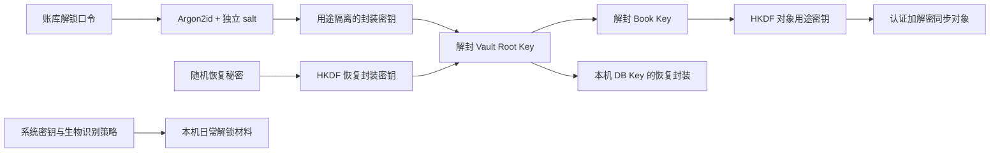

# 隐私威胁模型与端到端加密

本方案保护锁定状态的本机文件和服务端账务内容。解锁客户端需要读取明文，服务端只能保存密文和必要元数据。加密、访问控制、备份与数据删除是不同责任，不能相互替代。

## 1. 威胁与限制

| 威胁 | 目标控制 | 限制 |
| --- | --- | --- |
| 网络监听与劫持 | HTTPS + 对象 AEAD | 不能隐藏访问时间、流量和目的主机 |
| 服务端 / DB / 备份泄露 | 内容 E2EE、独立解锁秘密 | 弱口令封装可被离线猜测 |
| 服务端篡改对象 / 绑定字段 | AEAD、版本关系和本机检查点 | 不证明服务器没有遗漏或分叉 |
| 锁定手机文件被拷贝 | 加密 DB、系统密钥包装 | 已解锁、恶意系统或 root / jailbreak 不在完整保护范围 |
| 设备失窃 | 撤销访问，必要时新钥重建 | 无法追回已得到的明文或历史密钥 |
| 错误日志 / 崩溃 / 分享 | 最小日志、遮挡、显式脱敏 | 用户主动明文导出需要自行保管 |
| 密钥丢失 | 独立恢复资料与加密归档 | 全部解密材料遗失时服务商不能找回明文 |

服务端可以拒绝服务、隐藏有效对象或向不同设备展示不同历史。已知检查点能发现部分回滚 / 重放，首版不提供针对恶意服务端的完整透明日志或全局分叉证明。

## 2. 数据分级

| 数据 | 处理 |
| --- | --- |
| 金额、日期、备注、账户 / 分类名称、交易类型和业务引用 | 本机解锁使用；远端只存密文 |
| 根密钥、账簿密钥、恢复秘密、解锁口令和备份口令 | 客户端秘密，不进入日志、遥测、客服或服务端明文 |
| 密钥封装、nonce、算法 / 参数、随机 ID、修订、长度与访问关系 | 可存远端，最小化并披露 |
| 登录身份、密码哈希、会话、IP、延迟和错误码 | 服务运维数据，独立权限及保留期 |
| 用户主动 CSV | 明文交换文件，显式导出与临时文件清理 |

默认不接入广告、跨应用追踪或收集明文业务内容的分析 SDK。诊断先在本机生成，用户确认后才提交，密文正文也不进入普通日志。

## 3. 登录与解锁

登录账号负责访问所选实例，账库解锁负责获取客户端密钥。二者使用独立凭据：

- 登录密码使用服务端认证方案，管理员可重置访问身份。
- 账库解锁口令只在客户端参与 KDF；服务端只保存封装及参数。
- 日常生物识别用于本机已授权解锁材料，不代替独立恢复能力。

登录成功不授予解密能力，重置登录密码不重新生成账库或解密钥。首版新设备基线为“实例认证 + 账库解锁口令或恢复材料”；已有设备扫码配钥后置，避免提前增加另一套配对协议。

本地模式同样建立独立解锁 / 恢复材料。启用同步之前展示将上传的账库和密钥封装，不能默认上传现有本地数据。

## 4. 密钥层次

| 材料 | 生成与用途 |
| --- | --- |
| Vault Root Key | 客户端生成 256 位随机根材料，包装账簿和本机恢复材料 |
| Book Key | 每账簿 / epoch 随机生成，派生对象用途密钥 |
| Object Key | 由 Book Key 经 HKDF 的固定用途标签和对象 / 修订上下文派生 |
| Device DB Key | 每台设备独立随机密钥，保护本地 SQLCipher 库 |
| Recovery Secret | 独立 256 位随机秘密，派生恢复封装密钥 |
| Archive Key | 每份独立归档随机密钥，不复用同步钥或会话 |

候选派生 / 封装关系：

根材料和账簿钥均随机生成，不直接由登录密码或设备硬件 ID 决定。本机还保存由根材料保护的 DB Key 封装，以便系统生物识别项失效后用独立解锁材料读取未同步数据。

解锁需要的 salt、格式和封装保存在受限 bootstrap 中，不能只放在尚无法打开的加密 DB 内形成循环依赖。系统密钥路径和恢复路径在 M0 验证，不能把“失效后重新生成钥”当作恢复。

## 5. 算法候选与认证边界

- 对象与密钥封装优先评估 XChaCha20-Poly1305，256 位密钥、192 位系统随机 nonce，每次加密使用新 nonce。
- 对象和用途派生使用 HKDF-SHA256，固定域标签防止不同用途混用。
- 口令派生使用 Argon2id，保存独立 salt、参数和 profile；随机恢复秘密使用用途隔离 HKDF，不当作低熵口令。
- 优先评估 RustCrypto 依赖，不自己实现密码原语；版本、features、目标平台和许可在 M0 冻结。

Argon2id 可从 64 MiB、3 次迭代、1 路并行的候选开始实测，不把候选当作已冻结参数。参数有允许 profile 和资源上下界；拒绝弱化、极端资源值和未知算法，不能为低配设备静默降低已有封装强度。

AAD 以确定性编码绑定格式 / 算法、域身份、对象 / 修订 / 前置身份、key epoch 和经认证的操作语义。口令封装还绑定 KDF profile、参数与 salt。不要直接依赖普通 JSON 对象字段顺序。nonce 不可同钥复用；失败不得返回未认证明文。

服务端 cursor 不纳入客户端无法预知的加密输入，不宣称 cursor 已被 AEAD 证明可信。客户端还要验证依赖、版本关系与业务约束。

共享账簿密钥的设备都能产生有效 AEAD 对象，AEAD 不提供独立设备不可否认签名。首版设备归属依赖服务端会话控制；未来若需要抵抗恶意服务端伪造设备归因，另行评审签名与配对，不复制 Lex 的全部设备协议。

## 6. 本地加密与锁定

SQLCipher 使用随机 Device DB Key，与对象 E2EE 分开。确认实际库是加密构建，检查 DB、WAL、回滚日志、索引、临时文件和导出缓存。文件型临时存储需按实际构建禁用或保护，不能只检查主 DB。

iOS 评估仅本机、解锁可用的 Keychain 保护；Android 用 Keystore 钥包装本机解锁材料。硬件保护按实际能力报告，不把所有机型都称作硬件安全。密钥默认不随系统云备份迁移。

锁定后清理 UI 状态、临时明文和可清理密钥内存，暂停需解密工作；崩溃 dump、后台预览、剪贴板和系统分享另行检查。无法保证所有运行时内存都被绝对清零，重点是缩短驻留和控制副本。

本机 DB 或密钥不可取时保留文件，返回可解释错误。系统密钥取消、拒绝、失效和不支持分别验证。

## 7. 恢复材料与口令变更

恢复秘密为带版本和校验的可打印文本。恢复资料还需提供账库身份、必要封装和格式信息；只有秘密而没有数据不等于备份。要求确认已保存，不自动写入剪贴板、相册、云盘或系统备份。

| 操作 | 语义 |
| --- | --- |
| 改登录密码 | 变更身份凭据与会话策略，不改账务密钥 |
| 改解锁口令 | 验证现有解锁，生成新 salt / KDF 封装；根钥不自动轮换 |
| 忘记解锁口令 | 用恢复材料或仍可解锁设备重新封装 |
| 丢全部设备 | 需要远端密文 + 解密材料，或独立完整归档 |
| 失去全部解密材料 | 无法恢复明文；管理员不保留后门 |

旧口令封装的拷贝不能被技术追回，改口令不等于旧根钥失效。怀疑口令、恢复秘密或根钥泄露时进入新密钥重建。

## 8. 撤销与安全重建

普通设备撤销立即阻止对应会话的后续访问，不能撤回已下载内容或现有主密钥。怀疑设备失窃 / 密钥泄露时：

1. 撤销访问，完成可信客户端核对与独立备份。
2. 创建新 Vault generation、新根钥、账簿钥和恢复材料；若口令也可能泄露，同时更换解锁口令与登录凭据。
3. 将完整验证快照重新加密到暂存新域，限制旧域新增远端写入。
4. 校验事实集合、余额、关联、删除和候选后原子切换。
5. 其他设备重新授权；旧域离线修改显式导出核对，不直接写回。

过程可中断恢复，切换前保留可恢复旧副本。后续新数据在新钥下隔离；历史密钥、旧归档和已外泄明文仍可能被持有者读取。服务器不会被赋予“重加密用户明文”的能力。

重建和迁移复用经验证的数据快照与切换语义，但不在业务启动前抽取通用框架。

## 9. 发布前检查与依据

必须覆盖算法向量、篡改 AAD / 密文、随机 nonce、极端 KDF、格式 / 大小限制、两端系统密钥失效、独立恢复、日志与文件明文检查、撤销后重建和专项安全评审。

- [RFC 9106](https://www.rfc-editor.org/rfc/rfc9106)是 Argon2 的算法与参数参考；本项目 profile 需移动端实测。
- [XChaCha20-Poly1305 说明](https://doc.libsodium.org/secret-key_cryptography/aead/chacha20-poly1305/xchacha20-poly1305_construction)说明长 nonce 与随机使用方式，作为构造参考，不表示必须采用 libsodium。
- [SQLCipher 设计](https://www.zetetic.net/sqlcipher/design/)说明加密页面与临时文件边界。
- [Android Keystore](https://developer.android.com/privacy-and-security/keystore)与 [Apple Keychain 保护](https://support.apple.com/guide/security/keychain-data-protection-secb0694df1a/web)用于平台能力设计，实际保护等级与行为需真机验证。
